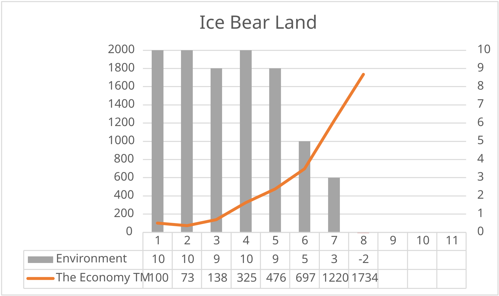

<!-- # Abstract -->

I introduce an interactive simulation game modelling innovation system functions.
The game is suitable for 10--15 players, requires no previous knowledge of innovation systems, takes 60 minutes to play and can be used for teaching as well as outreach activities.
It is free to play, requiring only a standard card deck and self-printable role cards.
All materials, including reflection questions and discussion assignments for classroom use are shared publicly under a permissive license.
The game has successfully been used with various Master's students, entrepreneurs, and different policymakers.

**Keywords:** innovation systems; serious games; sustainability transitions; experiential learning; simulation; transition education

# Introduction

A core framework to study sustainability transitions are innovation systems.
Innovation systems have been conceptualized at different geographic scales [e.g. @lundvall1992NationalSystemsInnovation; @cooke1992RegionalInnovationSystems] sectors [@malerba2002SectoralSystemsInnovation], or based on technological boundaries [@bergek2008AnalyzingFunctionalDynamics; @hekkert2007FunctionsInnovationSystems].
Regardless of their boundary, innovation systems share a holistic perspective on innovation as involving multiple actors with different roles, knowledge, and preferences.
In short, they are conceptualized as complex systems, which can make them confusing for newcomers and experts alike.

This perspective introduces an interactive simulation as a serious game for teaching and policy outreach to allow participants to discover key aspects of innovations systems through and immersive experience.
The game, its materials, and supplementary activities such as reflection workshops have been tested with students, entrepreneurs, and policymakers of different backgrounds and are made accessible under a permissive share-alike creative commons license.
Designed for 10--15 participants, the game simulates a model nation, consisting of different roles with shared and individual objectives, which aims to maximize economic welfare and ecological integrity by means of producing innovations.
Played across maximum ten rounds, the game unfolds over 60 minutes and is therefore easily integrated in a typical 90-minute seminar block, allowing for 30 minutes of immediate reflection and discussion.
The simulation is grounded in Hekkert et al.'s [-@hekkert2007FunctionsInnovationSystems] Functions of Innovation System article which can be assigned as reading to prepare or reflect on the observations.
Other foci, such as the role of geographical proximity in knowledge spillovers, are possible and discussed below.

Recently, @fernandezgaleote2025PlayGamesGamification called "to explore and leverage the potential of playful and gameful interventions in changing transition dynamics, environments, and actors for practice and regime-level system transformations" (p. 1).
The game introduced in this article represents an addition to the pedagogical toolkit of the sustainability transitions, and innovation systems communities to advance such interventions inside and outside the classroom.
After presenting some arguments for games as teaching and outreach aids, in the next section, I provide an overview of the game's rules, the replicated concepts and discusses absent concepts as opportunities for pedagogical interventions.
This is followed by an analysis of voluntary feedback collected across 23 participants.

# Games and sustainability transitions

The use of serious games has long enjoyed attention from pedagogy [e.g. @defreitas2018AreGamesEffective; @ullah2022SeriousGamesScience], games have been applied to teach macro-financial models [e.g. @mendez-carbajo2019ExperientialLearningMacroeconomics; @vanderlaansmith2013UnderstandingForeignExchange], business and accounting principles [e.g. @loon2015LearningStrategicManagement; @mastilak2012FirstDayStrategiesMillennial], and even sustainable development [@prado2020SimulationsCaseStudies], as well as circular economy and sustainable energy [@rociodelatorre2021RoleSimulationSerious].
A burgeoning literature has, among other aspects, investigated the circumstances under which games make successful teaching interventions, finding that they can enhance student motivation, engage students, and can be associated with behavioral change in students [@defreitas2018AreGamesEffective].

In sustainability transitions @fernandezgaleote2025PlayGamesGamification scoping review found 86 empirical outputs on gamification for sustainability transitions, finding that most games target individual and community level agency rather than conceptual understanding of transition dynamics.
The dominant design goal is to nudge consumption, energy use, or mobility choices [@stanitsas2019FacilitatingSustainabilityTransition;@fernandezgaleote2025PlayGamesGamification].
These are legitimate aims, but they operate at the level of individual action.
Games that help players understand *why* transitions are structurally difficult by not only observing but recreating institutional, political, and systemic features of complex sociotechnical systems, are rare.
Making such systemic reasons experienceable, however, allows for different, more direct learning, by allowing learners to experiment with short and direct feedback loops.

Second, most games surveyed were to a large extent digital.
While not inherently problematic, analog games offer additional benefits such as lowering practical barriers to implementation, and more memorable learning moments.
Negotiation, coalition-building, and the emergence of informal norms are processes better experienced around a table than through a screen.
If designed right, analog formats also lower costs to adapt games to new contexts, teaching or outreach objectives.

Third, few games are explicitly grounded in transitions theory. Games may simulate sustainability-relevant domains (energy, agriculture, urban planning), but they seldom operationalize specific analytical frameworks from the transitions literature as game mechanics. 
Innovation systems functions, multi-level dynamics, and regime resistance tend to appear in the post-game debrief rather than in the design itself.
@stanitsas2019FacilitatingSustainabilityTransition found that serious games for sustainability transitions do not typically offer a balanced view that integrates environmental, economic, and social aspects at once.

# The Innovation Systems Game

The full game materials, including role cards, a scoring spreadsheet, and facilitator instructions, are available under CC BY 4.0 at [pjkreutzer.com/innovation-systems-game](https://pjkreutzer.com/innovation-systems-game). 
Sharing the game under a permissive license hopefully stimulates adaptation and modification beyond what I alone can think of.
Facilitators may modify rules to foreground specific dynamics, restrict researcher mobility to teach clustering, delay environmental indicator updates to teach feedback lags, or adjust citizen preference distributions to explore different political coalitions.
This section describes the game, its set-up and roles, and how it operationalizes Hekkert et al.'s [-@hekkert2007FunctionsInnovationSystems] innovation system functions in its current version.
This version has been tested with multiple master student cohorts at Lund University between 2019 and 2026, as well as with policymakers and entrepreneurs in standalone workshops.
The website includes materials and suggestions for reflection assignments in both classroom and workshop settings.

## Setup and roles

The Innovation Systems for Sustainability game is an analog simulation for 10 to 15 players, lasting approximately 60 minutes. The only required materials are a standard 52-card deck and printed role cards. A scoreboard and timer help with facilitation but are not strictly necessary.

Players assume roles corresponding to actors in an innovation system: government, industry, university researchers, company researchers, innovators, citizens, and an NGO. Government and industry are assigned once each; the other roles may be duplicated depending on group size. The game runs for a maximum of ten rounds, each following a fixed sequence: innovation goals are set, innovators draw cards, innovators may play cards, citizens consume, outcomes are evaluated, and the round closes with discussion and negotiation of goals for the next round.
After every five rounds, a public election determines whether the current government retains its role.
Two aggregate indicators track the collective outcome: an economic indicator (starting at 100) and an environmental indicator (starting at 10, representing a pristine environment). 
For every 100 points of the economic indicator at the end of a round, the environment degrades by 1 unit.
The floor division is rounded up such that 150 points deduct 2 environmental units and even if the economic indicator falls below 100 points, 1 unit is deducted from the environment.
While there are several ways to affect the economic indicator (discussed below), there is only one mechanism to restore points to the environmental indicator: playing an "environmental innovation" restores one unit.
The game ends after 10 rounds, if the economic indicator is negative for two consecutive rounds, or if the environmental indicator reaches zero.

@fig-ice depicts an example from a real game, which the participants called "Ice Bear Land", played by Master's students at Lund University in 2021.
After three rounds of limited economic output, students grew more confident and ambitious in increasing the economic indicator.
Whereas they had no issues at first balancing environmental health, to offset deductions to the environmental indicator in round 8, they required 17 environmental innovations ($1734/100\approx17$).
However, in this round, they only played 15 environmental innovations, "destroying the environment" to below 0, thus ending the game.

::: {.content-visible when-format="html"}
{#fig-ice width=80%}
:::

::: {.content-visible when-format="pdf"}
{#fig-ice width=80%}
:::

The facilitator ensures that the game stays within the allotted time frame by reminding players of each required step, deciding when it is time to move on to the next round, as well as keeping score of and communicating outcomes.
Additionally, the facilitator may answer questions regarding the game's rules, and individual's tasks.
However, the facilitator may choose how to strict they wish to enforce these. The basic rules, described below, are deliberately left somewhat incomplete and open for interpretation.
Allowing for learning, adaptation, and self-organization of the players to take place.

##  How mechanics operationalize Innovation System functions

The game takes @hekkert2007FunctionsInnovationSystems's Functions of Innovations Systems as a departure point, aiming to replicate the majority of functions described therein and grounding the learning in widely-cited research on innovation systems.
The seven functions they identified are: i) entrepreneurial activities, ii) knowledge development, iii) knowledge diffusion through networks, iv) guidance of the search, v) market formation, vi) resource mobilization, vii) creation of legitimacy; and are operationalized within the game directly (through explicit rules and game mechanics) and indirectly (through emergent behavior during the game).

### Directly operationalized functions

Knowledge development and entrepreneurial activity is, on the surface, operationalized through the card-play mechanic.
Innovators generate innovations by playing pairs of cards with matching face values.
A pair played as an economic innovation adds twice the sum of its face values to the economic indicator.
A pair played as an environmental innovation adds only the sum of the face values to the economy, but also restores one point to the environmental indicator.
Playing four of a kind doubles the effect.
This distinction creates a built-in tension between the volume and the directionality of knowledge output: environmental innovations yield less economic return but address environmental degradation.

In order to play "innovations", innovators have to generate pairs from the cards on their hands.
They receive cards through funding (universities from the government, company researchers from industry funding).
Each card "costs" a five-point reduction of the economic indicator, so funders need to weigh investments against expected returns.
Thus, the players have to decide how many resources to mobilize to meet their desired innovation goals.
The rules permit innovators to play with open cards and thus pool their resources, increasing their chances for matching pairs of cards substantially.
This, however, is not described in the rules and requires active choices by the players.
It also comes with additional costs as they need to coordinate with multiple players who may possess different objectives.

Such resource sharing also serves as knowledge diffusion through networks.
Innovators diffuse what they know (the cards they hold on their hands) with their peers hoping for to increase the chance for successful combinations.
When these innovations are played and enter the simulated economy, they further diffuse into "economic use".
For facilitators this offers intervention opportunities to highlight specific concepts.
I could observe, for example, that while most teams eventually discovered that they could show each other their cards, some teams did not discover this, or only discovered it late into the game, because the players with innovator roles initially sat physically separated from each other.
This can easily be used to highlight the importance of (geographical) proximity for knowledge development and diffusion: players may, for example, be placed strategically by the facilitator and permitted to move before a certain round.

Influence on the direction of search is operationalized through two channels.
The industry player directs company researchers by specifying what type of innovation to pursue, while university researchers set their own goals.
The election after round five adds a political dimension.
Citizens vote openly on whether to retain the current government, and the incoming government may pursue a different agenda.
The direction of search is thus a product of negotiation and political contestation.
An idea for extending this simple approach with feedback from a rudimentary market mechanism has not yet been extensively tested but is described further below.

Creation of legitimacy is also directly included in the game, through the inclusion of discussion and negotiation of round outcomes and goals for following rounds.
But the extent to which this function becomes visible during the game depends on the player's own actions.
Most of the remaining functions are included in this more indirect manner.

### Indirect operationalization 

Broadening the perspective of what an innovation is from the easily visible technological artifact (here cards played as pairs) to behaviors surfaces a broader range of functions embedded in this game.
For example, players must develop the knowledge that they may coordinate with other innovators to increase the chances of finding matching cards.
Collectively, the players must learn how to best balance economic objectives with environmental objectives: should they play high face-value cards as economic or environmental innovations? how many cards should the government and industry make available to their innovators? how can the environmental NGO best achieve their goal of keeping the environment pristine?
These and more questions are solved in an experimental manner, sometimes individually, sometimes collectively, before diffusing to the rest of the players.
It is in these interactions that the game unfolds its potential as a teaching aid for surfacing and describing complex innovation systems functions.

Depending on the interests of the facilitator, a broader understanding of what constitutes an innovation may therefore yield richer post game discussions and learning.
For example, past games have shown high variance in the extent to which the government role intervened in the unfolding process.
Some governments chose to levy "taxes" on industry investment (taking one card for every five cards the industry passed to its researchers, for example), in hopes of steering innovation towards more environmental benefits.
As such novelties need not originate in the role ultimately responsible for enacting them also opens the door to critically discuss who and what constitutes entrepreneurial activity.

##  Incomplete rules as a design principle

This flexibility originates to a substantial part from the deliberately underspecified ruleset.
It does not prescribe whether government can legislate environmental innovation quotas, whether industry can fire its researchers, or whether citizens can refuse to consume.
When players discover these gaps, they encounter institutional voids.
What they do with them, whether they negotiate, legislate, exploit, or simply ignore the possibility, mirrors real institutional innovation.

And it is one of the game's most productive properties as it opens up the post-game reflection and discussion.
The rule set is succinct enough to ensure the game allows for a discussion about innovation systems and their functions, and flexible enough to allow for things to emerge dynamically.
When used with policymakers, entrepreneurs, or other practitioners it also invites fruitful debates about how the game's rules and roles differ from the roles and rules inhabited by the practitioners.

##  Limitations of the current design

The version of the game described here has not been tested with a market formation mechanism.
Innovations are played and scored, but there is no mechanism through which demand is articulated, niches are protected, or early markets are created.
An extension for including market formation outright is detailed on the game's website and may in the future become a core component of the simulation.
There are however also reasons speaking against this inclusion.
For one, including a market mechanism would add complexity that may not be warranted for a 60-minute session.
Second, the absence of market formation can also become a teaching tool: participants can be asked why innovations in the game do not "go anywhere" beyond their point value, and what would need to exist for them to diffuse into actual use.
It can also be useful to sharpen participants' analytical abilities when not all functions they expect are in fact present.

This trade-off between reality and abstract models further plays a role in the implicit assumptions that arise from the game's mechanics.
Two assumptions require active disclosure from facilitators in the post-game discussion to prevent participants from drawing factually wrong conclusion.

The first concerns the relationship between innovation and the environment.
In the game, the only way to improve the environmental indicator is through environmental innovation.
There is no mechanic for regulation that directly reduces environmental harm, no option for sufficiency or reduced consumption that restores environmental quality, and no representation of ecosystem recovery independent of technological intervention.
This is, to put it plainly, false.
Real environmental improvement comes from a far broader set of interventions, including demand reduction, behavioral change, institutional reform, and ecological restoration, none of which require technological innovation.
The game's mechanics encode the techno-optimistic assumption that environmental problems are solved through better technology, foreclosing the possibility that they might also be solved by doing less or doing differently.
The mechanic does, however, serve a clear design purpose.
It enforces directionality as a meaningful choice: innovators and their funders must decide between economic and environmental outcomes, and that trade-off drives much of the game's strategic tension.
While useful, this simplification is not innocent and should therefore be put up for active debate during the reflection period: what does it mean that the game only lets you fix the environment through innovation? What alternatives does this rule make invisible?

The second assumption concerns collaboration.
In the current design, there is no real cost to collaboration between innovators.
Since innovations require pairs of matching cards, pooling hands increases the probability of a match.
Players who discover this can coordinate to maximize innovation output.
This makes for engaging dynamics: the moment students realize they can share cards is often a turning point in the game, and it creates a natural entry point for discussing knowledge diffusion, clustering, and the benefits of open innovation. The problem is that real collaboration is not costless.
Coordination requires time, trust, and institutional infrastructure.
Knowledge sharing involves transaction costs, intellectual property concerns, and competitive risks.
Facilitators may levy the "punishment" of not allowing any innovations to be played if the innovators take too long to agree on which cards to play, but since cards remain in play, the innovations can simply be played in a later round, thus fully collaborating is always the dominant strategy.
Therefore, the game overstates the ease of knowledge diffusion and understates the institutional work required to make it happen.

Both assumptions are, in a sense, wrong on purpose.
They simplify in order to make other dynamics legible within a 60-minute session.
And while the pedagogical risk is that students absorb the simplification as a description of reality, the pedagogical opportunity, which in practice I have found to be the more common outcome, is that students learn to interrogate the assumptions embedded in any model.
When asked to identify what the game gets wrong, students practice exactly the kind of assumption hunting that is essential to working with formal models, scenarios, and policy simulations [@saltelli2020TechniqueNeverNeutral].

## Reflecting on the game in a post-hoc discussion---from play to learning

The seminar design that accompanies the game integrates a reflection paper assignment in which students analyze the game experience using Hekkert et al.'s [-@hekkert2007FunctionsInnovationSystems] functions framework, followed by small-group and plenary discussion.
This combination of play, individual reflection, and collective debriefing is where much of the learning consolidates [@westera2019WhyHowSerious;@lew2021GamebasedLearningTeaching].
In addition to the seven functions, the game's learning objectives aim to develop key sustainability competencies, such as Systems Thinking Competence, Strategic Competence, Interpersonal Competence, Anticipatory Competence, and Normative Competence [@wiek2011KeyCompetenciesSustainability], through interaction, experimentation, and reflection.

Participant feedback across two cohorts (n=23) provides initial support that the game and seminars are constructively aligend with these learning objectives.
All but one participant reported gaining a deeper understanding of innovation systems.
The game was overwhelmingly rated as fun (15 "extremely agree," 7 "somewhat agree") and satisfaction with learning outcomes was high (13 "very satisfied," 9 "satisfied," 1 "dissatisfied").
And post-game discussions were consistently valued across both cohorts.

It should be acknowledged that the somewhat open and ambiguous rules can also be a source of discomfort for players and facilitators.
Not knowing what is expected can be uncomfortable for players, while not knowing what will happen might be uncomfortable for those wishing to teach specific aspects predictably.
To alleviate these shortcomings, a thoughtful and well-planned reflection following the game is of utmost importance.
Here this discomfort, should it arise, can and should be reflected upon.
An effective tool for this is structured de-roling: asking participants to actively point out how their *roles* differed from their *person* can be one such way.
This can be particularly helpful where dissonance between the role's and players' beliefs, values, and norms exists.
Making it salient for all participants that the actions in game do not need to correspond with actions of the person is the responsibility of the facilitator.

It is the facilitator's task to ensure that the game fits into the learning context (e.g. that it arrives at the appropriate spot in a course, or that it is tied to a specific workshop question) [@lew2021GamebasedLearningTeaching].
While such consideration needs to occur before the game is deployed, the adaptable nature of the game itself provides rich flexibility for what to highlight during the reflection session.
An important reminder in this context is further that the learning goals should trump gameplay [@westera2019WhyHowSerious].
There should be a clear goal for the game, beyond it being a fun and different activity, and the facilitator should monitor if the gameplay diverges too far from the desired learning goals, both during the game itself and the following reflection.

As already mentioned, the game can also be applied outside traditional classroom settings.
First experiences with entrepreneurs and policymakers suggests that the game can serve as a useful translation device to engage with different audiences.
The game has been used with entrepreneurs to broaden their perspective from product-level thinking to systemic positioning: where does their offering sit within the broader innovation system, and how does it challenge or reproduce existing institutional rules? It has also been used with policymakers from the Swedish Energy Agency as an opening exercise to reflect on their current policy approaches, their role within the system, and the limits of their capacity to steer innovation.
In both cases, the game functioned as a shared experience that made transition governance challenges tangible through play rather than through briefings, allowing for fruitful discussions and as a bridge between the analytical vocabulary of transition studies and the practical reasoning of actors who shape transitions without necessarily using that vocabulary.

#  Conclusion

Sustainability transitions are complex, contested, and systemic. The tools we use to teach and communicate them should reflect that.
This Perspective has introduced an analog simulation game that operationalizes innovation systems functions as game mechanics, reported initial evidence that it makes innovation system dynamics experientially accessible.
I hope that it can contribute to more diverse teaching and outreach materials and invite anybody who is interested to use, modify, and adapt the game and its resources.
I equally welcome feedback and reflections on how to use and develop this game in diverse settings.

# References