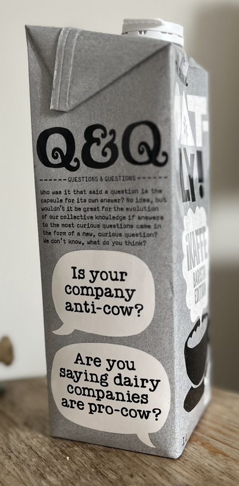

# The Game {.inverted}

## Rule Reminder 

:::{.r-fit-text}

1. Set innovation goals 🎯
2. Innovators draw cards 💸
3. Innovators may play cards 🛠️
   1. Economic Innovation = Sum of face value x 2
   2. Environmental Innovation = Sum of face value + 1 environmental point
   3. Four of a kind = all effects double
4. Consume (while 2 and 3 happen) 🛍️
5. Discuss outcomes and state of game 💬
6. Negotiate innovation goals. Fight to make your role happy with how it is going! 📣

:::

## Round 1

:::{.timer #ROUND-1 seconds=300 starton=interaction}
:::

## Round 2

:::{.timer #ROUND-2 seconds=300 starton=interaction}
:::

## Test Market Mechanism

1. Citizens get tokens to adopt innovations
2. Innovators play innovations to a market-place in round $t$
3. Citizens spend tokens to adopt $t+1$
4. Innovations enter with same effects in round $t+1$

## Round 3

:::{.timer #ROUND-3 seconds=300 starton=interaction}
:::

## Round 4

:::{.timer #ROUND-4 seconds=300 starton=interaction}
:::

## Reflection

What surprised you in the way the game unfolded? Were there critical moments in which the game could have developed differently?

What would have been needed to have a different game?

## Innovation Iceberg Heuristic

# Innovation Systems -- A Brief Introduction

## Innovation System Functions

1. Entrepreneurial Activities
2. Knowledge Development
3. Knowledge Diffusion Through Networks
4. Guidance of the Search
5. Market Formation
6. Resources Mobilisation
7. Creation of Legitimacy

[@hekkert2007FunctionsInnovationSystems]{.slide-cite}

## Motors of Change

:::{.fragment style="position: absolute; bottom: 25%; right: 0%; width: 35%; height: 33%; background-color: hsla(4, 80%, 63%, 0.8); border-radius:5px;"}
:::

[@hekkert2007FunctionsInnovationSystems 426]{.slide-cite}

## Navigate Innovation Systems as an Entrepreneur

::: {.columns .v-center-container}
::: {.column}
Which of these functions do you participate in?

:::{.box .bg-royal-blue-200}

1. Entrepreneurial Activities
2. Knowledge Development
3. Knowledge Diffusion Through Networks
4. Guidance of the Search
5. Market Formation
6. Resources Mobilisation
7. Creation of Legitimacy

:::

:::
::: {.column .fragment}

Take a systems perspective to create new ideas, engage with stakeholders, shape operations or strategy.

:::
::: 

[@hekkert2007FunctionsInnovationSystems]{.slide-cite}

## Leverage Points to Intervene in Systems

[@meadows2009LeveragePointsPlaces]{.slide-cite}

:::{.attribution style="color: hsl(210, 11%, 71%);"}
Image credit: [Monash University](https://www.behaviourworksaustralia.org/blog/how-systems-thinking-compliments-behavioural-approaches-in-solving-complex-problems)
:::

---

### Example: Oatly marketing working towards paradigm shift 

::: {.columns .v-center-container}
::: {.column}

1. Knowledge Diffusion
2. Creating Legitimacy

Repeatedly pointing out flaws in existing food (dairy) paradigm.

:::
::: {.column}

{width=50%}

:::
::: 

## Reflection

What role do you (personally) have at as a sustainability entrepeneur? Was it different from your role in the game? How did you view the role that you usually have in the game?

What aspects of the game did you recognize from reality?

# Innovation is a systemic event. Applying systemic tools can help identify new solutions to stubborn problems.

## Game Resources



[https://pjkreutzer.github.io/innovation-systems-game/](https://pjkreutzer.github.io/innovation-systems-game/)

## Feedback 



[https://forms.office.com/e/9yesS7saGb](https://forms.office.com/e/9yesS7saGb)

## References