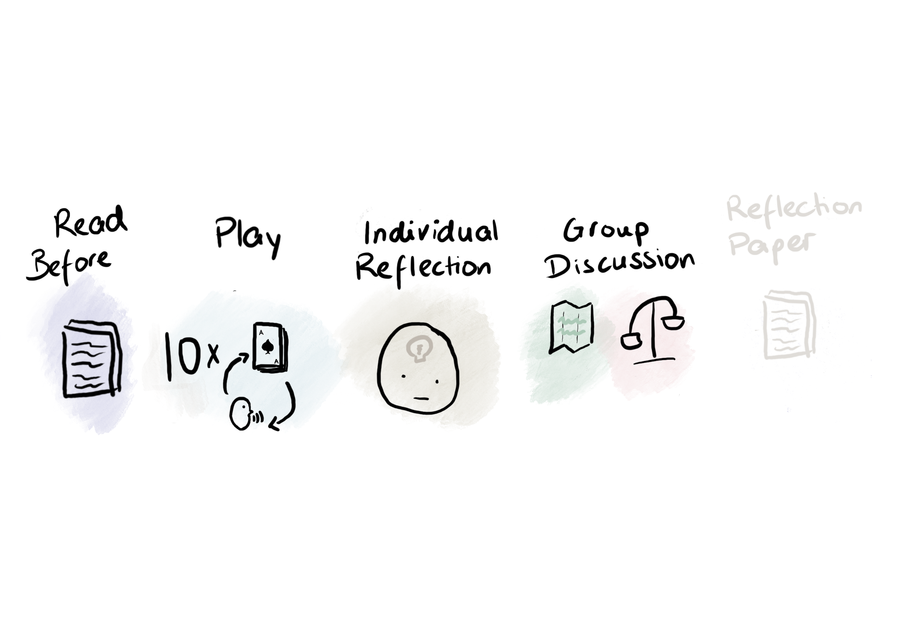
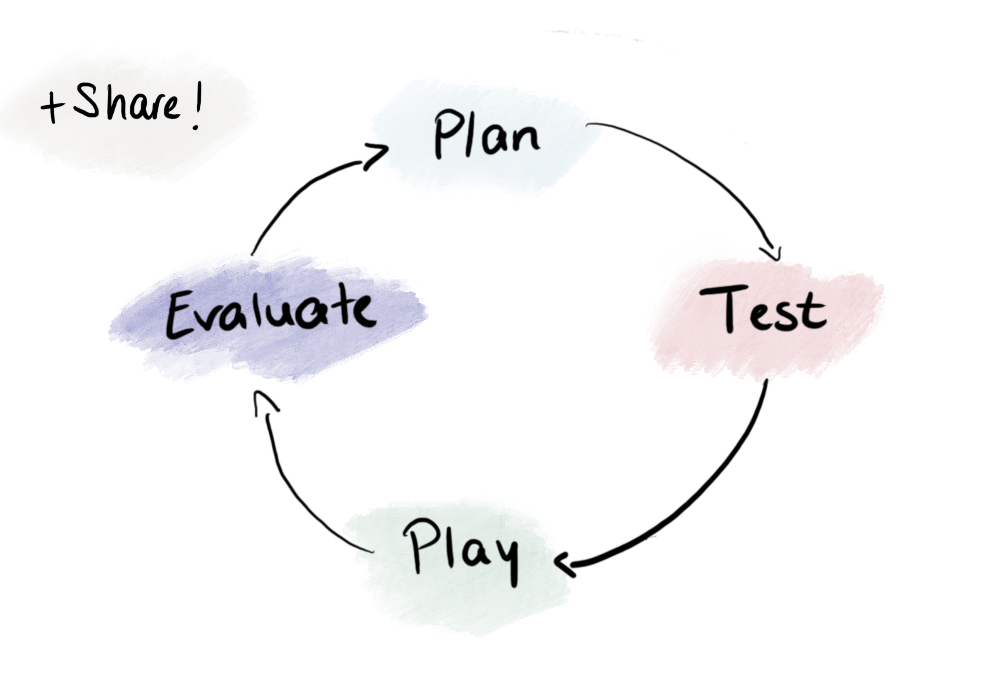

## Recap

{#fig-is-overview}

---

{#fig-is-development}

[[see also @lew2021GamebasedLearningTeaching;@fischer2020GamificationNovelDidactical]]{.slide-cite}

## Key Factors for Successful Teaching Games

1. Learning goals trump gameplay [@westera2019WhyHowSerious]
2. Game fits into learning context [@loon2015LearningStrategicManagement;@gonzalez-gonzalez2021LimitsGamification;@lew2021GamebasedLearningTeaching]
3. Provide space for reflection: (before), during, after [@westera2019WhyHowSerious;@lew2021GamebasedLearningTeaching]

# The Game {.inverted}

## Rule Reminder 

:::{.r-fit-text}

1. Set innovation goals 🎯
2. Innovators draw cards 💸
3. Innovators may play cards 🛠️
4. Consume (while 2 and 3 happen) 🛍️
5. Discuss outcomes and state of game 💬
6. Negotiate innovation goals. Fight to make your role happy with how it is going! 📣

:::

## Round 1

:::{.timer #ROUND-1 seconds=300 starton=interaction}
:::

## Round 2

:::{.timer #ROUND-2 seconds=300 starton=interaction}
:::

## Round 3 --- Election 🗳️

:::{.timer #ROUND-3 seconds=180 starton=interaction}
:::

## Round 4

:::{.timer #ROUND-4 seconds=180 starton=interaction}
:::

## Round 5 --- 🏁 Last Round! 

:::{.timer #ROUND-5 seconds=180 starton=interaction}
:::

## Reflection

What surprised you in the way the game unfolded? Were there critical moments in which the game could have developed differently?

What would have been needed to have a different game?

What types of innovation did you notice?
Who was responsible for them? Where did they originate from?

## Innovation Iceberg Heuristic

# Innovation Systems -- A Brief Introduction

## Innovation System Functions

1. Entrepreneurial Activities
2. Knowledge Development
3. Knowledge Diffusion Through Networks
4. Guidance of the Search
5. Market Formation
6. Resources Mobilisation
7. Creation of Legitimacy

[@hekkert2007FunctionsInnovationSystems]{.slide-cite}

## Motors of Change

:::{.fragment style="position: absolute; bottom: 25%; right: 0%; width: 35%; height: 33%; background-color: hsla(4, 80%, 63%, 0.8); border-radius:5px;"}
:::

[@hekkert2007FunctionsInnovationSystems 426]{.slide-cite}

## Game Resources



[https://pjkreutzer.github.io/innovation-systems-game/](https://pjkreutzer.github.io/innovation-systems-game/)

## Feedback 



[https://forms.office.com/e/9yesS7saGb](https://forms.office.com/e/9yesS7saGb)

## Feedback II: Improvements of Market Mechanism

How can I include market mechanisms that,

1) make the game more realistic and covers more motors of change and 
   
1) make the game more engaging for citizens?

## References